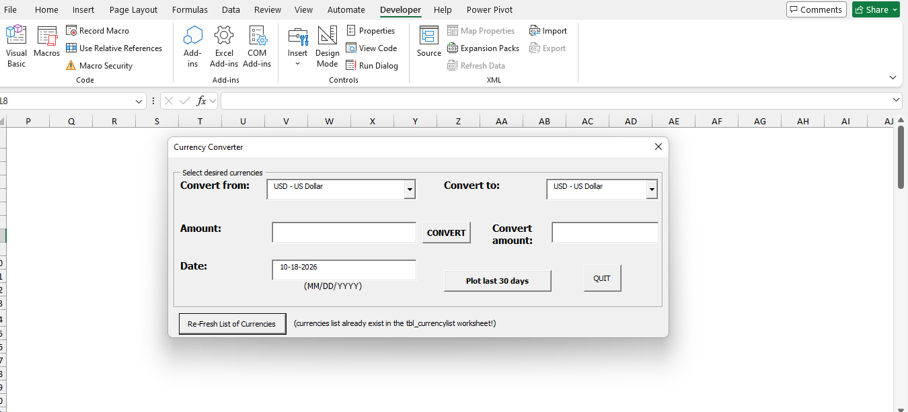
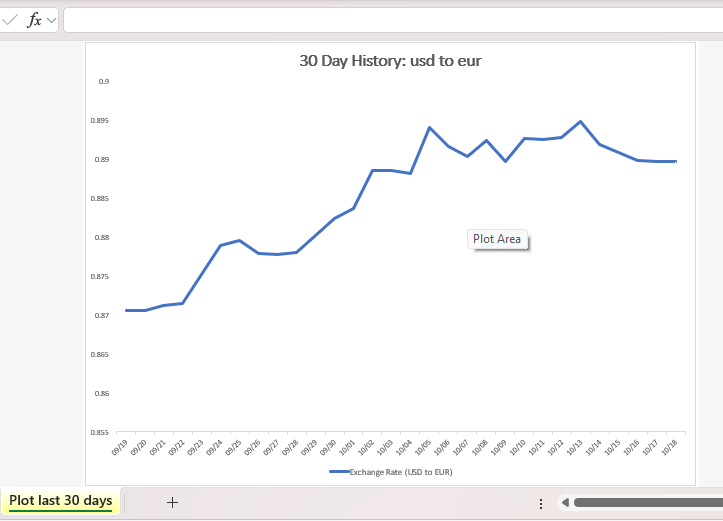

# 💱 MS Excel Live & Historical Currency Converter (VBA)

An interactive **Microsoft Excel VBA application** that fetches live and historical foreign exchange rates via REST API, performs instant cross-currency conversions, refreshes live ISO currency lists, and generates automated 30-day historical trend charts.

---

## ✨ Key Features

* **Live & Historical Exchange Rates:** Queries real-time and historical exchange rates (back to 1999+) using `MSXML2.ServerXMLHTTP.6.0`.
* **Dual-CDN Failover Architecture:** Automatically routes requests through jsDelivr CDN (`@fawazahmed0/currency-api`) and falls back to Cloudflare Pages (`currency-api.pages.dev`) if a network firewall blocks the primary endpoint.
* **Automated 30-Day Historical Charting:** Dynamically queries 30 consecutive days of historical rates and builds a formatted Excel Line Chart sheet (`Plot last 30 days`) while keeping the raw staging sheet (`30DayPlot`) hidden (`xlSheetVeryHidden`).
* **Modeless UserForm Interface:** Runs in `vbModeless` mode so users can interact with worksheet tabs and inspect the 30-day chart while the calculator remains open on screen.
* **Live Currency Table Refresh:** Includes a built-in Web Query refresh button (`Re-Fresh List of Currencies`) that updates the backend `tbl_currencylist` table and dynamically repopulates dropdowns.
* **Locale-Safe Date & JSON Parsing:** Custom native VBA JSON parser (`ExtractRate`) and regional-independent date parser (`TryParseDate`) with zero external library dependencies.

---

## 📂 Repository Contents

| File | Description |
| :--- | :--- |
| `Currency_Converter.xlsm` | Main macro-enabled Excel workbook containing the interface and backend tables |
| `GetExcRate_and_ExtractRate.bas` | Standard VBA module handling HTTP requests, CDN failover, JSON parsing, and date validation |
| `frm_currcalc.frm` / `.frx` | VBA UserForm source code and binary layout for the Currency Converter dialog |

---

## 🚀 How to Use

1. Download **`Currency_Converter.xlsm`** from this repository.
2. Open the file in Microsoft Excel (2016 or newer on Windows) and click **Enable Content** (Enable Macros) if prompted.
3. On the **Instructions** tab, click the **Currency Converter** button.
4. Select your **Convert from** and **Convert to** currencies, enter an **Amount** and **Date (`MM/DD/YYYY`)**, and click **CONVERT**.
5. Click **Plot last 30 days** to generate and view the 30-day historical exchange rate line chart.
